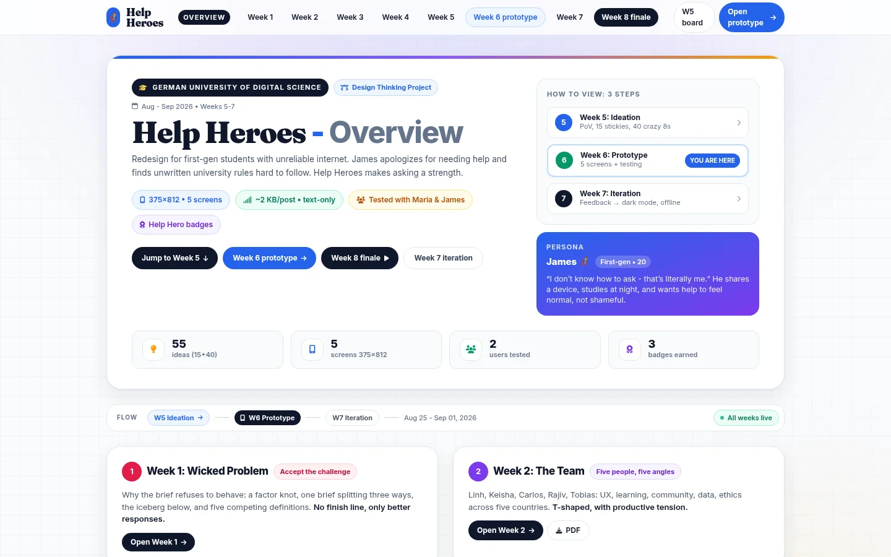

# Help Heroes

**An eight-week Design Thinking case study for first-generation students, from interviews to a narrated prototype.**

[Live case study](https://nyght-x-walker.github.io/help-heroes-mockup/) · [Week 8 finale](https://nyght-x-walker.github.io/help-heroes-mockup/week8.html) · [Reflection](week7_reflection.md)

## What's inside

- `index.html` — overview landing for Weeks 1–8
- `week1.html` — wicked problem, factor knot, prism, iceberg, and risks
- `week2.html` — team, T-shapes, tension diagram, and first impressions
- `week3.html` — problem space, mind map, chapters, and interviews
- `week4.html` — synthesis, quotation flowers, PoVs, and HMW questions
- `week6.html` — first prototype
- `index_week7.html` — prototype updated from testing feedback
- `week8.html` — final presentation prototype with timed speaker notes
- `audio/` — studio narration for the Week 8 slides
- `testing_board.html` — testing notes from Maria and James
- `week7_reflection.md` — process reflection

## View

Open `index.html` for the overview, `week8.html` for the finale deck, or `index_week7.html` for the tested prototype. Everything is static HTML with relative links; there is no build step.

## Process

The case study follows a full Design Thinking arc: interviews, problem framing, synthesis, ideation, wireframing, prototyping, usability testing, iteration, and a narrated final presentation. The work focuses on first-generation students and the friction they meet when navigating support systems.
